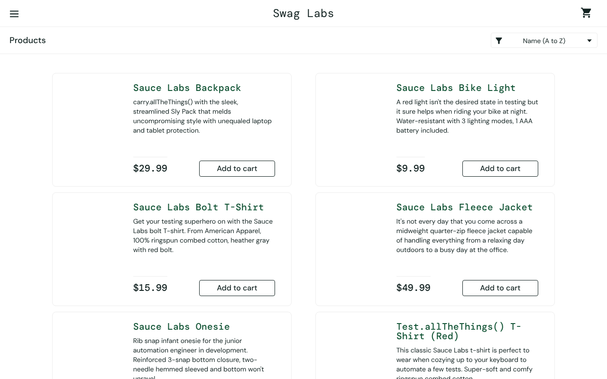

# BUG-001: All products display the same image on Products page

> Demo bug report written for portfolio purposes on the public practice site SauceDemo.

| Field | Details |
|---|---|
| **Bug ID** | BUG-001 |
| **Title** | All products display the same image on Products page |
| **Module** | Product Listing |
| **Bug Type** | UI |
| **Severity** | Major |
| **Priority** | High |
| **Status** | Open |
| **Reported By** | Aadesh Awasthi |
| **Environment** | Windows 11, Google Chrome (latest), 1920 x 1080 |
| **Application** | SauceDemo, https://www.saucedemo.com |
| **Test User** | `problem_user` |

## Description

All six products show the same dog image, which does not match any product. This is different from the expected behaviour seen with `standard_user` and from normal e-commerce behaviour.

## Steps to Reproduce

1. Open https://www.saucedemo.com
2. Login with `problem_user` / `secret_sauce`
3. Observe the product images on the Products page

## Expected Result

Each product shows its own relevant image.

## Actual Result

All six products show the same dog image, which does not match any product.

## Reproducibility

Always (3 out of 3 attempts)

## Attachments

## Notes

- Retest after fix and run the related regression test cases for the **Product Listing** module.
