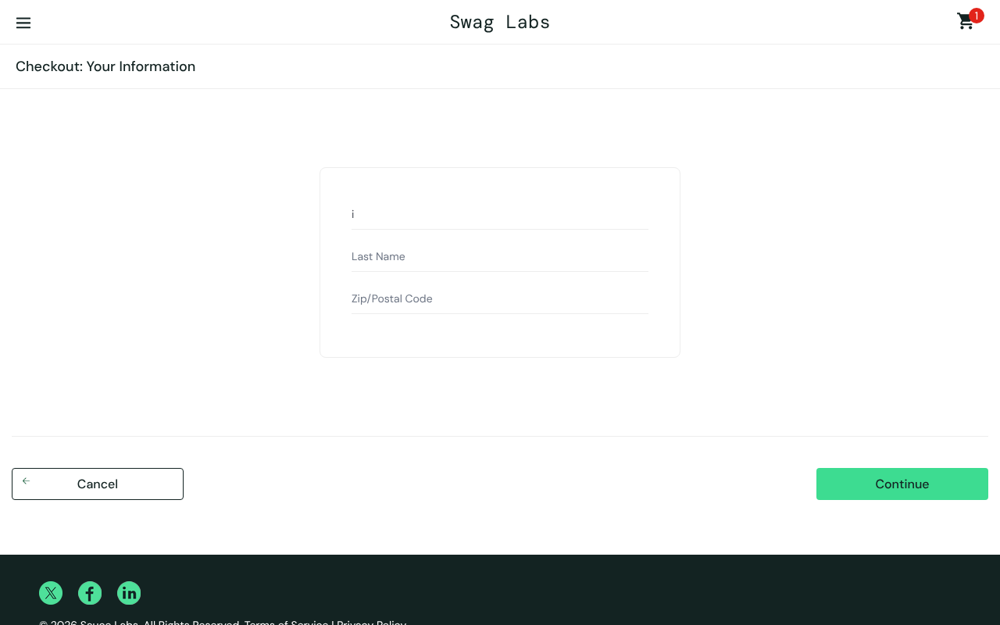

# BUG-003: Typing in Last Name field changes the First Name field on checkout

> Demo bug report written for portfolio purposes on the public practice site SauceDemo.

| Field | Details |
|---|---|
| **Bug ID** | BUG-003 |
| **Title** | Typing in Last Name field changes the First Name field on checkout |
| **Module** | Checkout |
| **Bug Type** | Functional |
| **Severity** | Critical |
| **Priority** | High |
| **Status** | Open |
| **Reported By** | Aadesh Awasthi |
| **Environment** | Windows 11, Google Chrome (latest), 1920 x 1080 |
| **Application** | SauceDemo, https://www.saucedemo.com |
| **Test User** | `problem_user` |

## Description

Last Name field stays empty and the First Name value is replaced by the last typed character ("i"). On Continue the error "Error: Last Name is required" is shown, so the user cannot complete checkout. The same steps work correctly with `standard_user`.

## Steps to Reproduce

1. Open https://www.saucedemo.com
2. Login with `problem_user` / `secret_sauce`
3. Add any product to cart and open the cart
4. Click Checkout
5. Enter "Aadesh" in First Name
6. Type "Awasthi" in Last Name
7. Enter Postal Code and click Continue

## Expected Result

Last Name field accepts the typed value and First Name stays unchanged.

## Actual Result

Last Name field stays empty and the First Name value is replaced by the last typed character ("i"). On Continue the error "Error: Last Name is required" is shown, so the user cannot complete checkout.

## Reproducibility

Always (3 out of 3 attempts)

## Attachments

## Notes

- Retest after fix and run the related regression test cases for the **Checkout** module.
