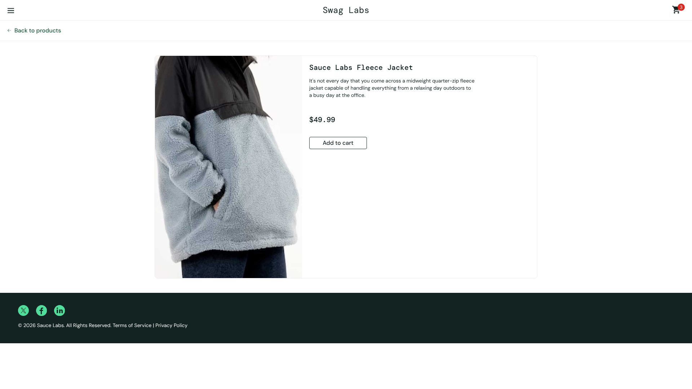

# BUG-006: Clicking a product name opens a different product detail page

> Demo bug report written for portfolio purposes on the public practice site SauceDemo.

| Field | Details |
|---|---|
| **Bug ID** | BUG-006 |
| **Title** | Clicking a product name opens a different product detail page |
| **Module** | Product Details |
| **Bug Type** | Functional |
| **Severity** | Major |
| **Priority** | Medium |
| **Status** | Open |
| **Reported By** | Aadesh Awasthi |
| **Environment** | Windows 11, Google Chrome (latest), 1920 x 1080 |
| **Application** | SauceDemo, https://www.saucedemo.com |
| **Test User** | `problem_user` |

## Description

Detail page of a different product (Sauce Labs Fleece Jacket) opens. The same steps work correctly with `standard_user`.

## Steps to Reproduce

1. Open https://www.saucedemo.com
2. Login with `problem_user` / `secret_sauce`
3. Click on the "Sauce Labs Backpack" title
4. Observe the product shown on the detail page

## Expected Result

Detail page of Sauce Labs Backpack opens.

## Actual Result

Detail page of a different product (Sauce Labs Fleece Jacket) opens.

## Reproducibility

Always (3 out of 3 attempts)

## Attachments

## Notes

- Retest after fix and run the related regression test cases for the **Product Details** module.
