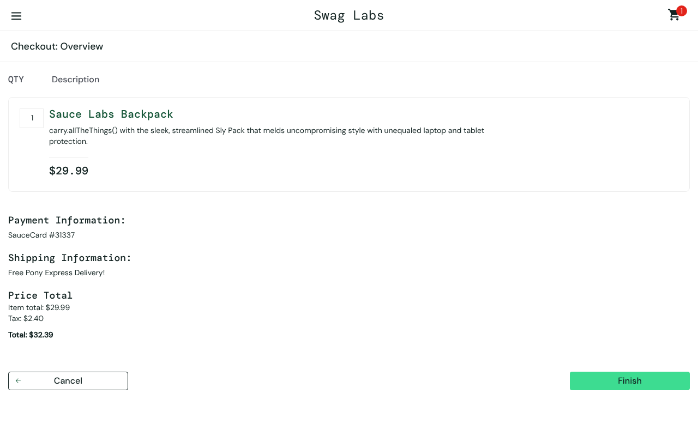

# BUG-010: "Finish" button does not complete the order

> Demo bug report written for portfolio purposes on the public practice site SauceDemo.

| Field | Details |
|---|---|
| **Bug ID** | BUG-010 |
| **Title** | "Finish" button does not complete the order |
| **Module** | Checkout |
| **Bug Type** | Functional |
| **Severity** | Blocker |
| **Priority** | High |
| **Status** | Open |
| **Reported By** | Aadesh Awasthi |
| **Environment** | Windows 11, Google Chrome (latest), 1920 x 1080 |
| **Application** | SauceDemo, https://www.saucedemo.com |
| **Test User** | `error_user` |

## Description

Nothing happens when Finish is clicked. User stays on the Overview page and cannot complete the order. The same steps work correctly with `standard_user`.

## Steps to Reproduce

1. Open https://www.saucedemo.com
2. Login with `error_user` / `secret_sauce`
3. Add Sauce Labs Backpack to cart
4. Go to cart and click Checkout
5. Fill the checkout information form and click Continue
6. Click Finish on the Overview page

## Expected Result

Order is placed and "Thank you for your order!" page is shown.

## Actual Result

Nothing happens when Finish is clicked. User stays on the Overview page and cannot complete the order.

## Reproducibility

Always (3 out of 3 attempts)

## Attachments

## Notes

- For this user the Last Name field also does not accept typed text, but Continue still opens the Overview page.
- Retest after fix and run the related regression test cases for the **Checkout** module.
