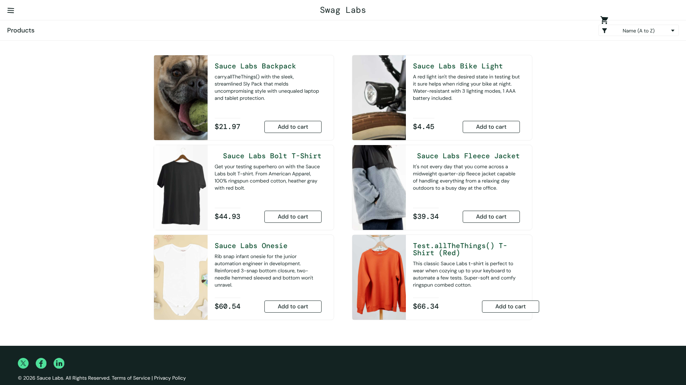

# BUG-011: Cart icon is misaligned in the header

> Demo bug report written for portfolio purposes on the public practice site SauceDemo.

| Field | Details |
|---|---|
| **Bug ID** | BUG-011 |
| **Title** | Cart icon is misaligned in the header |
| **Module** | Header |
| **Bug Type** | UI |
| **Severity** | Minor |
| **Priority** | Low |
| **Status** | Open |
| **Reported By** | Aadesh Awasthi |
| **Environment** | Windows 11, Google Chrome (latest), 1920 x 1080 |
| **Application** | SauceDemo, https://www.saucedemo.com |
| **Test User** | `visual_user` |

## Description

Cart icon is shifted from its normal position and looks out of line with the header. This is different from the expected behaviour seen with `standard_user` and from normal e-commerce behaviour.

## Steps to Reproduce

1. Open https://www.saucedemo.com
2. Login with `visual_user` / `secret_sauce`
3. Observe the cart icon at the top right of the Products page

## Expected Result

Cart icon is aligned at the top right, same as for standard_user.

## Actual Result

Cart icon is shifted from its normal position and looks out of line with the header.

## Reproducibility

Always (3 out of 3 attempts)

## Attachments

## Notes

- Retest after fix and run the related regression test cases for the **Header** module.
