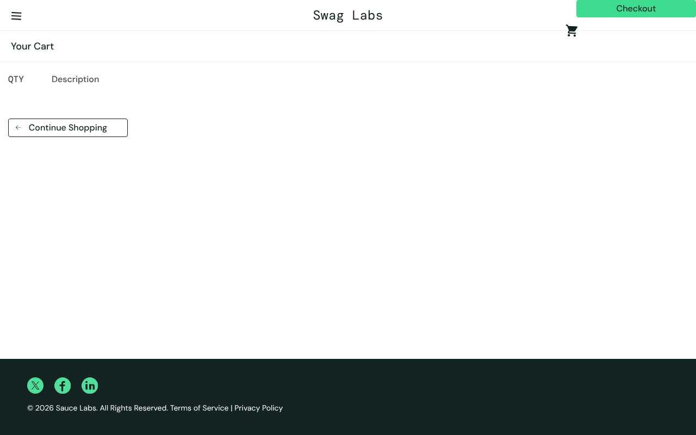

# BUG-013: Checkout button is misaligned on Cart page

> Demo bug report written for portfolio purposes on the public practice site SauceDemo.

| Field | Details |
|---|---|
| **Bug ID** | BUG-013 |
| **Title** | Checkout button is misaligned on Cart page |
| **Module** | Shopping Cart |
| **Bug Type** | UI |
| **Severity** | Minor |
| **Priority** | Low |
| **Status** | Open |
| **Reported By** | Aadesh Awasthi |
| **Environment** | Windows 11, Google Chrome (latest), 1920 x 1080 |
| **Application** | SauceDemo, https://www.saucedemo.com |
| **Test User** | `visual_user` |

## Description

Checkout button is displayed at the top right corner of the page, overlapping the header area, instead of the bottom right. The same steps work correctly with `standard_user`.

## Steps to Reproduce

1. Open https://www.saucedemo.com
2. Login with `visual_user` / `secret_sauce`
3. Add any product to cart
4. Open the cart page
5. Observe the Checkout button

## Expected Result

Checkout button is aligned at the bottom right, in line with Continue Shopping.

## Actual Result

Checkout button is displayed at the top right corner of the page, overlapping the header area, instead of the bottom right.

## Reproducibility

Always (3 out of 3 attempts)

## Attachments

## Notes

- Retest after fix and run the related regression test cases for the **Shopping Cart** module.
