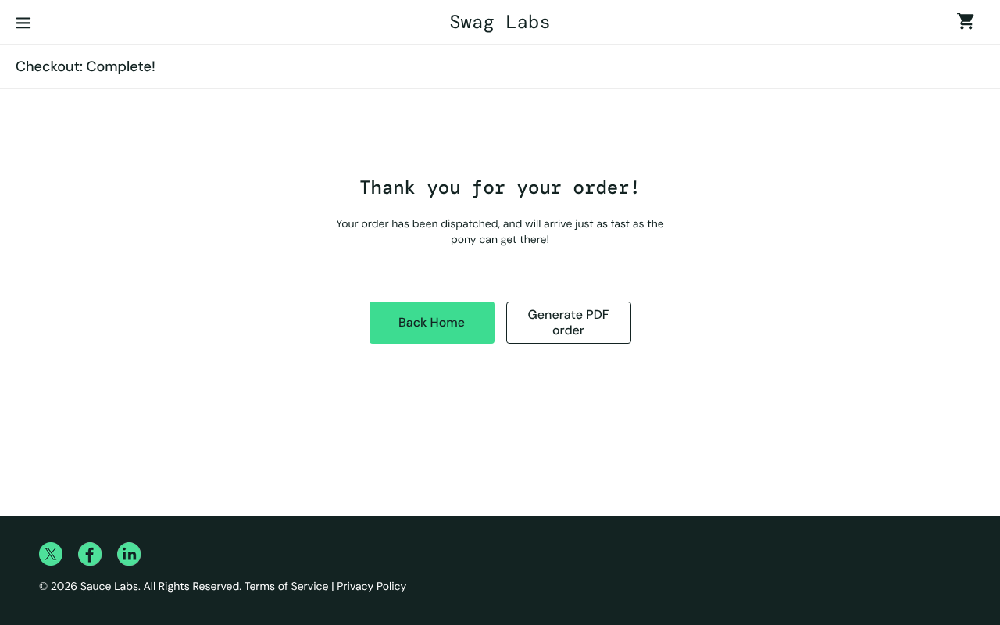

# BUG-014: User can proceed to checkout with an empty cart

> Demo bug report written for portfolio purposes on the public practice site SauceDemo.

| Field | Details |
|---|---|
| **Bug ID** | BUG-014 |
| **Title** | User can proceed to checkout with an empty cart |
| **Module** | Checkout |
| **Bug Type** | Functional |
| **Severity** | Major |
| **Priority** | Medium |
| **Status** | Open |
| **Reported By** | Aadesh Awasthi |
| **Environment** | Windows 11, Google Chrome (latest), 1920 x 1080 |
| **Application** | SauceDemo, https://www.saucedemo.com |
| **Test User** | `standard_user` |

## Description

User can complete the full checkout and sees "Thank you for your order!" with Item total $0. As a result, an order with no items and a $0 total can be placed.

## Steps to Reproduce

1. Open https://www.saucedemo.com
2. Login with `standard_user` / `secret_sauce`
3. Make sure the cart is empty
4. Click the cart icon
5. Click Checkout, fill the form, click Continue and then Finish

## Expected Result

Checkout button is disabled, or a message "Your cart is empty" is shown.

## Actual Result

User can complete the full checkout and sees "Thank you for your order!" with Item total $0.

## Reproducibility

Always (3 out of 3 attempts)

## Attachments

## Notes

- Retest after fix and run the related regression test cases for the **Checkout** module.
