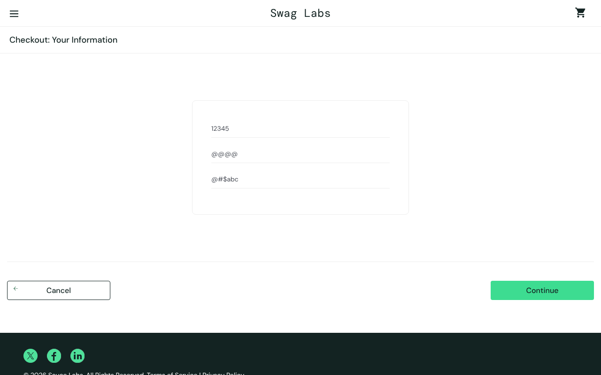

# BUG-015: Postal Code field accepts alphabets and special characters

> Demo bug report written for portfolio purposes on the public practice site SauceDemo.

| Field | Details |
|---|---|
| **Bug ID** | BUG-015 |
| **Title** | Postal Code field accepts alphabets and special characters |
| **Module** | Checkout |
| **Bug Type** | Validation |
| **Severity** | Minor |
| **Priority** | Medium |
| **Status** | Open |
| **Reported By** | Aadesh Awasthi |
| **Environment** | Windows 11, Google Chrome (latest), 1920 x 1080 |
| **Application** | SauceDemo, https://www.saucedemo.com |
| **Test User** | `standard_user` |

## Description

The value is accepted and user moves to the Overview page. This is different from the expected behaviour seen with `standard_user` and from normal e-commerce behaviour.

## Steps to Reproduce

1. Open https://www.saucedemo.com
2. Login with `standard_user` / `secret_sauce`
3. Add a product, open cart and click Checkout
4. Enter First Name and Last Name
5. Enter `@#$abc` in Zip/Postal Code
6. Click Continue

## Expected Result

A validation message is shown for an invalid postal code.

## Actual Result

The value is accepted and user moves to the Overview page.

## Reproducibility

Always (3 out of 3 attempts)

## Attachments

## Notes

- Retest after fix and run the related regression test cases for the **Checkout** module.
