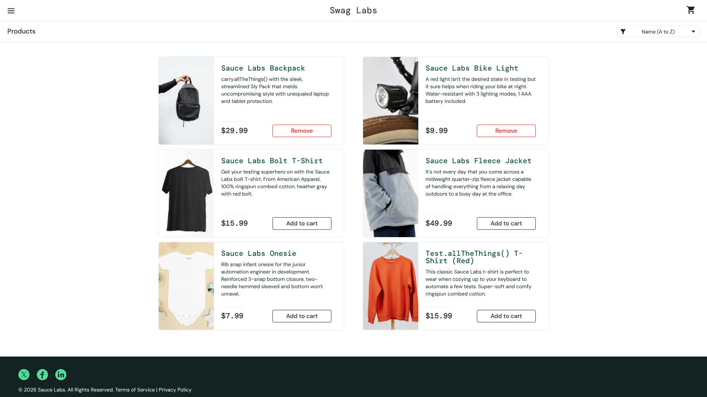

# BUG-017: "Reset App State" does not reset the "Remove" buttons

> Demo bug report written for portfolio purposes on the public practice site SauceDemo.

| Field | Details |
|---|---|
| **Bug ID** | BUG-017 |
| **Title** | "Reset App State" does not reset the "Remove" buttons |
| **Module** | Navigation Menu |
| **Bug Type** | Functional |
| **Severity** | Minor |
| **Priority** | Medium |
| **Status** | Open |
| **Reported By** | Aadesh Awasthi |
| **Environment** | Windows 11, Google Chrome (latest), 1920 x 1080 |
| **Application** | SauceDemo, https://www.saucedemo.com |
| **Test User** | `standard_user` |

## Description

Cart badge is cleared but both buttons still show "Remove" until the page is refreshed. This is different from the expected behaviour seen with `standard_user` and from normal e-commerce behaviour.

## Steps to Reproduce

1. Open https://www.saucedemo.com
2. Login with `standard_user` / `secret_sauce`
3. Click "Add to cart" on two products
4. Open the burger menu and click "Reset App State"
5. Close the menu and observe the product buttons

## Expected Result

Cart badge is cleared and both buttons change back to "Add to cart".

## Actual Result

Cart badge is cleared but both buttons still show "Remove" until the page is refreshed.

## Reproducibility

Always (3 out of 3 attempts)

## Attachments

## Notes

- Retest after fix and run the related regression test cases for the **Navigation Menu** module.
