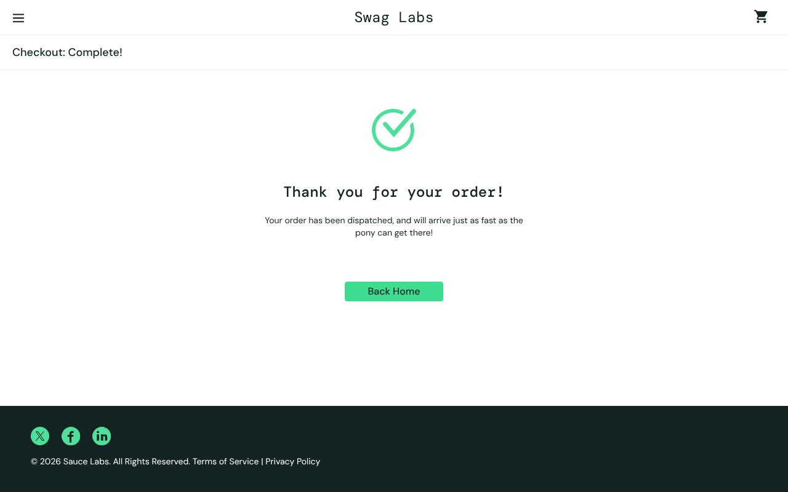

# BUG-019: Order confirmation page can be opened directly by URL

> Demo bug report written for portfolio purposes on the public practice site SauceDemo.

| Field | Details |
|---|---|
| **Bug ID** | BUG-019 |
| **Title** | Order confirmation page can be opened directly by URL |
| **Module** | Checkout |
| **Bug Type** | Security |
| **Severity** | Major |
| **Priority** | Medium |
| **Status** | Open |
| **Reported By** | Aadesh Awasthi |
| **Environment** | Windows 11, Google Chrome (latest), 1920 x 1080 |
| **Application** | SauceDemo, https://www.saucedemo.com |
| **Test User** | `standard_user` |

## Description

"Thank you for your order!" page is displayed even though no order was placed. As a result, an order confirmation can be shown without any order.

## Steps to Reproduce

1. Open https://www.saucedemo.com
2. Login with `standard_user` / `secret_sauce`
3. Do not add any product or start checkout
4. Open https://www.saucedemo.com/checkout-complete.html directly

## Expected Result

User is redirected to the Products or Cart page because no order was placed.

## Actual Result

"Thank you for your order!" page is displayed even though no order was placed.

## Reproducibility

Always (3 out of 3 attempts)

## Attachments

## Notes

- Retest after fix and run the related regression test cases for the **Checkout** module.
