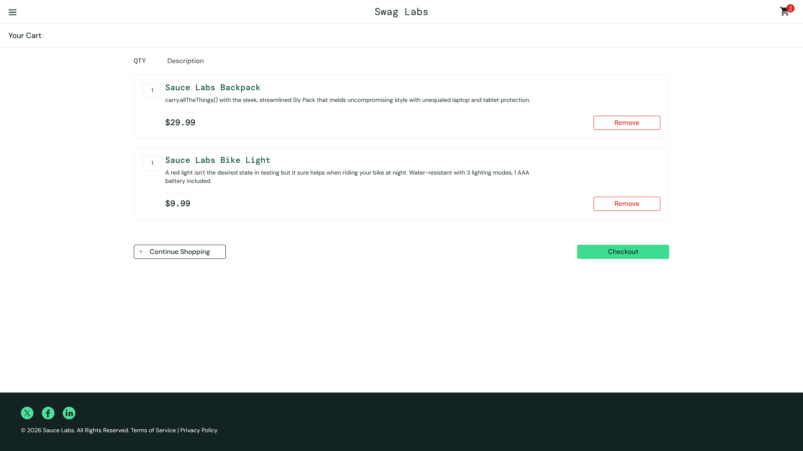

# BUG-020: Cart items of one user are visible to another user on the same browser

> Demo bug report written for portfolio purposes on the public practice site SauceDemo.

| Field | Details |
|---|---|
| **Bug ID** | BUG-020 |
| **Title** | Cart items of one user are visible to another user on the same browser |
| **Module** | Shopping Cart |
| **Bug Type** | Security |
| **Severity** | Critical |
| **Priority** | High |
| **Status** | Open |
| **Reported By** | Aadesh Awasthi |
| **Environment** | Windows 11, Google Chrome (latest), 1920 x 1080 |
| **Application** | SauceDemo, https://www.saucedemo.com |
| **Test User** | `standard_user / problem_user` |

## Description

Cart badge shows 2 and the items added by the first user are visible to the second user. Cart data is kept in the browser and is not cleared on logout, so the next user on the same browser sees it.

## Steps to Reproduce

1. Open https://www.saucedemo.com
2. Login with `standard_user` / `secret_sauce`
3. Add two products to cart
4. Logout from the menu
5. Login with `problem_user` / `secret_sauce`
6. Observe the cart badge and open the cart

## Expected Result

Cart of the second user is empty. Cart data belongs to one user only.

## Actual Result

Cart badge shows 2 and the items added by the first user are visible to the second user.

## Reproducibility

Always (3 out of 3 attempts)

## Attachments

## Notes

- The cart is also retained when the same user logs out and logs in again.
- Retest after fix and run the related regression test cases for the **Shopping Cart** module.
